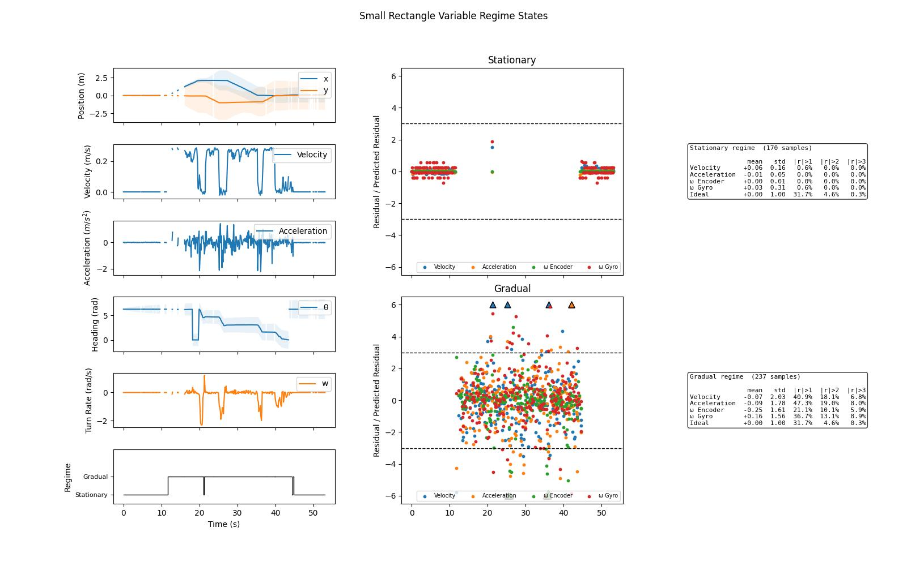
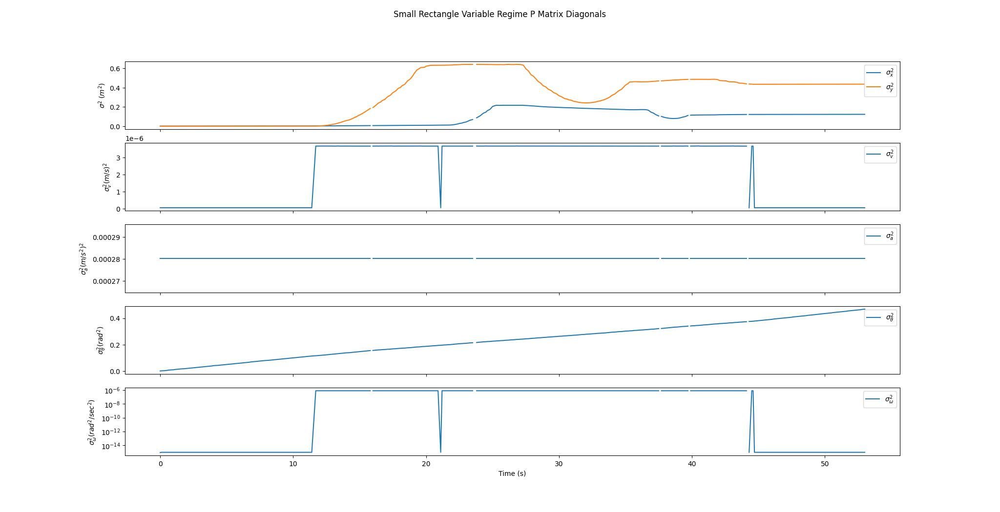
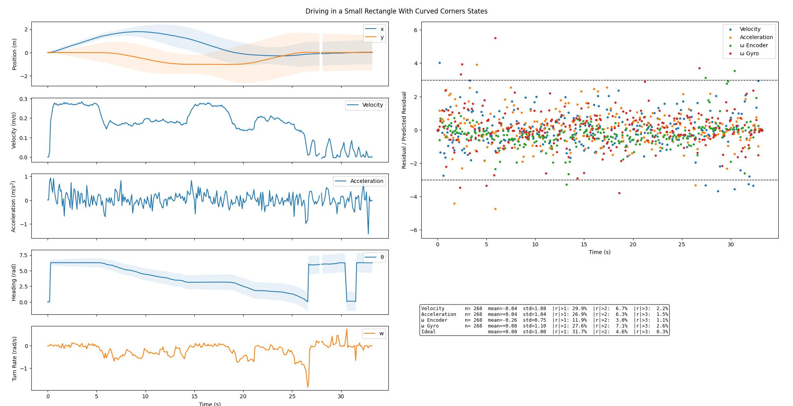
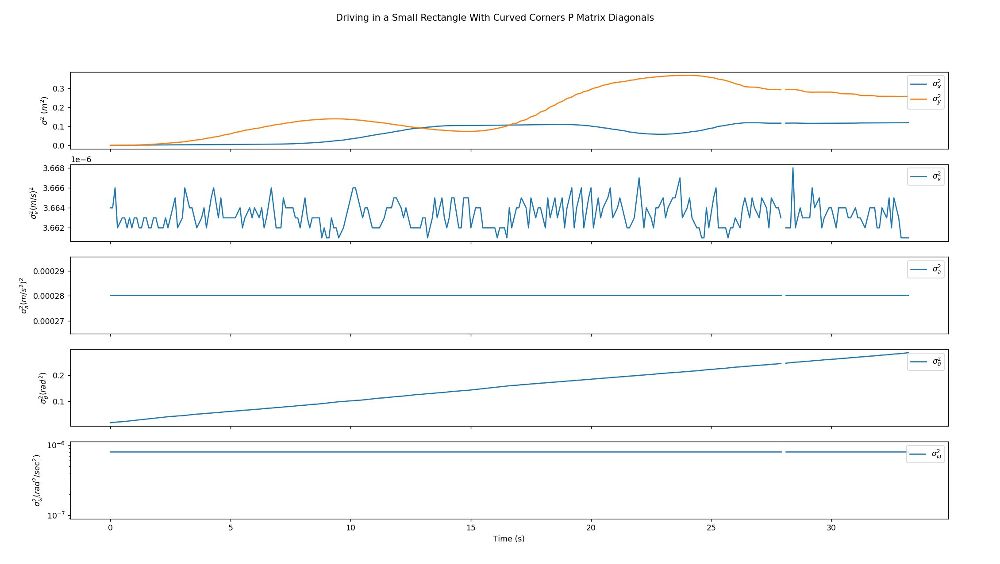
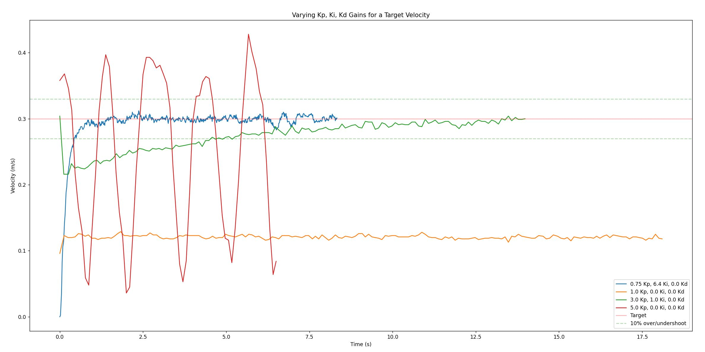
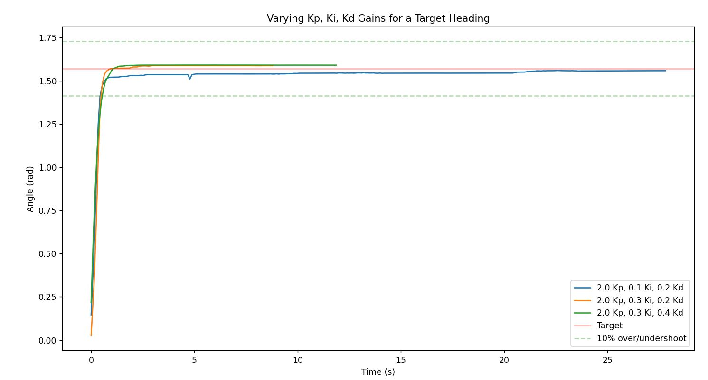

## Features / Overview
- A deterministic, fault-tolerant embedded control system in C++ on a resource constrained ESP32 microcontroller with FreeRTOS priority-scheduled tasks, a fixed rate control loop, and hardware abstraction across motors, sensors, and vehicle classes
- State machine architecture that safely handles faults, state transitions, and hardware fail-safes on communication loss
- UDP telemetry pipeline for remote logging with pre-allocated queuing and a dedicated FreeRTOS task to separate logging from the time constrained, prioritized control loop 
- Extended Kalman Filter (EKF) estimates pose in real time by fusing IMU and odometry measurements
- Autonomous open-field return to home navigation capability using EKF state estimation and PID controller in a Sense -> Estimate -> Control cycle 
- Remote control manual operation via Bluetooth
- Python tools that parse logs and plot EKF and PID performance across runs on a shared time axis


PICTURES / VIDEOS GO HERE


## Skills developed
- Kalman Filtering, Extended Kalman Filtering
- PID control
- Embedded real-time control software, RTOS, prioritized control tasks
- UDP, remote telemetry logging
- State machine design
- Data processing and plotting (Python, Pandas, Matplotlib) 
- Circuitry, circuit schematic design, 3D modeling


## Design Considerations
#### Remote Logging
- Singleton design pattern to ensure one logger and one log queue
- Separate logging FreeRTOS task with lower priority than control task to ensure control is not held up by telemetry
- Non-blocking queue, if the queue is full messages are purposely dropped so the control task is not held up 
- Pre-allocated memory for log message queue to prevent dynamic memory allocation faults with queue size being determined by available RAM, expected log rate, and message size
- Log messages sent over UDP for its low overhead as opposed to TCP since a delivery acknowledgment was not necessary and an occasionally dropped log was acceptable
- Formatted consistently with timestamp so python scripts can parse logged data for analysis and tuning 

#### State Machine and Fault Tolerance
- Explicit state machine with states: Manual, Autonomous, Bluetooth Pairing, Connected and Disarmed, Sensor Calibration
- State transitions handled explicitly and each mode runs its own per-cycle operations, including on entry setup
- Safety critical arming: a connection or reconnection always lands in Connected and Disarmed, forcing an operator to arm the system once it's connected in order to operate it
- Fault handling such as a sudden disconnect forces Pairing mode and stops the motors
- Operator can switch to Manual at any time during Autonomous control with single button push
- Status LEDs show the mode (slow blink while pairing, fast blink in autonomous, red LED while armed, yellow while calibrating sensors)
- Bounded WiFi connection retries 


 
#### Embedded Software Design
- Deisgned with seperate FreeRTOS tasks for logging and control	
	- Fixed memory, no `new`/`malloc` calls
	- Allow task prioritization and allocation of operation time based on task priority (control task higher priority than logging)
	- Deterministic fixed timing loop control task for EKF and PID 
	- Ability to add future tasks to expand capabilities 
- Hardware abstraction accross motors, sensors, and vehicle classes
	- Build abstraction interfaces to make the system hardware agnositc, allowing us to easily interchange future hardware (IMUs, motors, encoders)

#### Extended Kalman Filter
The Kalman Filter fuses acceleration and gyro data from an IMU and wheel encoder data from the motors to estimate the car's state. The state vector $\bar{x}$ evolves as a function of the previous state: 

```math
\bar{x} = [x,\ y,\ v,\ a,\ \theta,\ \omega]^T \\[6pt]
\bar{x}_{k+1} = f(\bar{x}_k) 
```

Since this motion model is nonlinear, an Extended Kalman Filter (EKF) was required. The Jacobian below was used to linearize the system at the current state estimate

```math
\begin{array}{rcl}
x_{k+1} & = & x_k + (v_k\,\Delta t + a_k\,\Delta t^2/2)\cos(\theta_k) \\[6pt]
y_{k+1} & = & y_k + (v_k\,\Delta t + a_k\,\Delta t^2/2)\sin(\theta_k) \\[6pt]
v_{k+1} & = & v_k + a_k\,\Delta t \\[6pt]
a_{k+1} & = & a_k \\[6pt]
\theta_{k+1} & = & \theta_k + \omega_k\,\Delta t \\[6pt]
\omega_{k+1} & = & \omega_k
\end{array}
\quad \xrightarrow{\ \ \partial f / \partial \bar{x}\ \ } \quad
A_{jacobian} = \begin{bmatrix}
1 & 0 & \Delta t\cos\theta & \Delta t^2\cos\theta/2 & -\left(v\,\Delta t + a\,\Delta t^2/2\right)\sin\theta & 0 \\[10pt]
0 & 1 & \Delta t\sin\theta & \Delta t^2\sin\theta/2 & \left(v\,\Delta t + a\,\Delta t^2/2\right)\cos\theta & 0 \\[10pt]
0 & 0 & 1 & \Delta t & 0 & 0 \\[6pt]
0 & 0 & 0 & 1 & 0 & 0 \\[6pt]
0 & 0 & 0 & 0 & 1 & \Delta t \\[6pt]
0 & 0 & 0 & 0 & 0 & 1
\end{bmatrix}
```

<br><br>

Measurement update timing, $\Delta t$
- Although a fixed rate control loop was implemented, a jitter analysis was not performed, therefore a variable $\Delta t$ (measured at the time of measurement) was used in the prediction step of the EKF and PID loop to increase accuracy of the filter

Variable motion model and sensor noise matrices 
- The car experienced varying amounts of wheel slippage which affected the filter's motion mode, $Q$, and encoder sensor noise, $R$, depending on how aggressively the car was being driven and the terrain it was being driven on. This increased the EKF's accuracy as its trust in the encoder sensors changed accordingly depending on the driving regime.
- Driving intensely -> $Q \uparrow$ (motion noise increases due to wheel slip), $R_{encoders} \uparrow$ (trust encoders less)
- Stationary -> $Q \downarrow$ (motion noise decreases due to no wheel slip), $R_{encoders} \downarrow$ (trust encoders more)
- This change also prevents unbounded drift in the car's heading estimate. This drift came from integrating the gyro's turn rate measurements which had a slight bias that was difficult to remove entirely. This bias was near constant (proved to grow over time very slowly with python analysis), and therefore, when integrated, produced a linearly increasing drift in the car's heading estimate, even when completely stationary. The variable $R$ and $Q$ matrices changed how much the gyro measurement was trusted when the car was completely stationary, preventing the intgeration drift

Verification and Validation
- Tuned R with data recorded from sensors
- Tuned Q empirically using plots
- NI plots
	- Mean of 0, NI std of 1
- State plots
	- Matched semi-known paths
- P diagonal plots

<table>
  <tr>
    <th colspan="2" align="center">Regime-Adaptive EKF Driving in Small Rectangle: States, Normalized Innovation, and Covariance (P) Diagonals </th>
  </tr>
  <tr>
    <td align="center">
      
      <br/><sub><b>Figure 1.</b> Estimated states and normalized innovation</sub>
    </td>
    <td align="center">
      
      <br/><sub><b>Figure 2.</b> Covariance (P matrix) diagonals</sub>
    </td>
  </tr>
  <tr>
    <th colspan="2" align="center">Single Regime EKF Driving in Small Rectangle With Curved Corners: States, Normalized Innovation, and Covariance (P) Diagonals</th>
  </tr>
  <tr>
    <td align="center">
      
      <br/><sub><b>Figure 3.</b> Estimated states and normalized innovation</sub>
    </td>
    <td align="center">
      
      <br/><sub><b>Figure 4.</b> Covariance (P matrix) diagonals</sub>
    </td>
  </tr>
</table>

#### PID Controllers
- The car ran two autonomous controllers, one PI controller for the car's forward velocity and one PID controller for its heading
- The two controllers' outputs were fed to the car's control class concurrently allowing it to move forward and steer simultaneously towards its destination

Velocity PI Controller
- Only proportional and integral gains were used for speed control. Adding a derivative gain to this controller caused large spikes in the step response. This is attributed to noisy accelerometer data feeding velocity estimates and quantized velocity measurements. Since the wheel encoders are only capable of measuring in steps, and our $\Delta t$ was very small, the velocity estimate could jump up and down and the derivative gain would see accelerations much higher or lower than the true acceleration. 

Heading PID Controller
- A derivative gain was useful in this case because the turn rate estimate was dominated by the IMU gyro (gyro had a much smaller value in $R$ matrix), which had small noise compared with the real turn rate, allowing the derivative term to differentiate a smooth error curve, leading to a successful damping effect.

Deadband Compensation
- As the heading error became small the PID output wasn't strong enough to overcome friction and the car would was unable to close the error completely. This wasnt a big problem when testing the velocity and heading controllers individually, but when combining inputs in the autonomous return to home navigation, the problem became apparent
- To solve this, the heading PID output is thresholded so the steering command is only ever left, right, or none, which means the car turns at a fixed rate when the PID demand saturates and drives straight otherwise. This is effectively on/off steering with a deadband around the target heading
- The trade-off is that the controller can no longer approach the target smoothly, so heading accuracy is limited by the deadband and fixed turn rate, but this is acceptable for the purposes of this project

Verification and Validation
- Step response data was recorded and plotted for analysis in tuning the PID controllers. Example response plots are below





## Project Limitations
- IMU magnetometer
- Limited sensors, integration error buildup


## Design Directory

[Schematic](Design/Schematic)

[Parts](Design/PartsList)

[Third Party Library Information](Design/ThirdPartyLibInfo)